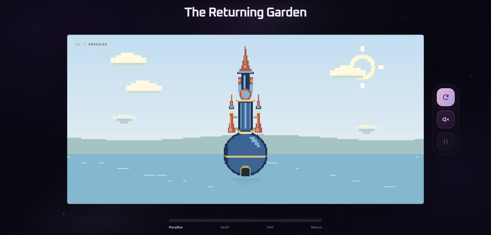

# The Returning Garden

**IDEA9103 Creative Coding Final — ZIQIAN LI**

The Returning Garden is an interactive p5.js work inspired by the blue tower in Hieronymus Bosch's *The Garden of Earthly Delights*. A building redrawn from small rectangles remains at the centre of a sixty-second journey through Paradise, Earth, Hell and Return. A pale celestial garden, a warm living landscape and a dark volcanic world give the stages distinct identities. Drifting clouds and an optional ambient soundtrack animate the scene. Clicking the tower brings the world back to Earth and restarts that part of the journey.



## Run the project

1. Download or clone the complete repository, keeping its folders intact.
2. Open the project folder in Visual Studio Code.
3. Open `index.html` with **Live Server**. Use the local HTTP address it opens in your browser.
4. Select the upper **circular-arrow icon** to enter the garden. Select the **speaker icon** to hear the soundtrack and see the tower breathe. Hover over an icon to see its action name.

No build command, package installation or external CDN is required. The p5.js and p5.sound files are included in `libraries/`, and the soundtrack is stored locally. Use a local web server rather than opening the HTML through a `file://` address, so the browser can load the audio asset correctly.

## Interaction instructions

| Action | Result |
|---|---|
| Upper circular-arrow icon | Starts the visual journey. Its hover and accessible name changes from Enter garden to Restart cycle; the arrow icon stays the same. |
| Click a visible pixel of the tower, or press **E** | Moves the same world timeline to the beginning of Earth. Earth then continues towards Hell and Return. Repeating the action restarts Earth. |
| **R**, or the circular-arrow icon after entry | Restarts the world timeline at Paradise. It does not rewind the soundtrack or generate a new set of clouds. |
| **P**, or the lower bars/play icon | Pauses or resumes world time, including light-dust and ember motion. The icon changes from pause bars to a play triangle when paused. Clouds and playing audio can continue. |
| **Space**, or the middle speaker icon | Plays or pauses the optional soundtrack. Its state changes between muted and sounding speaker icons, with the action name Turn sound on or Turn sound off. The sound button can also start the garden. Shortcuts become active after entry. |

The three icons sit vertically beside the artwork. Their action names are available on hover and through accessibility labels. Click outside the tower's visible cells to leave the timeline unchanged. Click empty canvas space if a shortcut needs focus. Space on a focused button activates that button normally. The phase label and continuous progress pill show world time.

Sound starts only after a user action. This project plays a supplied audio file and **does not request microphone access**. If the file cannot load, the visual work remains available and the page displays an audio message.

## Inspiration and interpretation

The reference is the blue spherical building near the upper centre of the painting's central panel. I retained the sphere, tall blue shaft, coral spire, gold bands and paired side ornaments. I removed the surrounding figures and detailed decoration to make a single, legible pixel structure. The title and repeating journey connect the original painting's contrasting worlds with a new idea of recovery: darkness is a stage, and colour can return.

The approved **V2 concept image was generated with AI assistance**. It provided a visual direction, not a finished p5.js drawing or a strict pixel-data blueprint. `Castle` reinterprets that concept as a **48-column by 128-row logical grid**. The running artwork draws grid cells with `rect()`; it does not display the V2 PNG as the tower.

The source painting is credited at [Wikimedia Commons](https://commons.wikimedia.org/wiki/File:Garden_delights.jpg). The four-stage cycle and the interactive behaviour are developed for this project rather than reproduced from the painting.

## Techniques and how the code works

### A shared world clock

`WorldClock` in `time-mechanic.js` owns the sixty-second timeline. It uses `millis()`, modulo, and four fifteen-second stages. Paradise and Earth each hold their palette for ten seconds and blend towards the next palette for five seconds. Hell holds its palette, and Return blends from Hell back to Paradise over its full fifteen seconds.

Each palette gives semantic names to the sky, water, clouds and building colours. `lerpColor()` changes them together. The main sketch applies an additional frame-based colour easing step using `deltaTime / 550`; this softens manual jumps as well as automatic changes. It is an easing response, not a fixed-duration 550 ms animation.

### Three distinct environments

`WorldDetails` in `world-details.js` draws the environmental symbols with small rectangles. Paradise has a hollow ivory halo, fourteen light specks and two floating terraces. Earth has a warm sun and four clusters of fruit shrubs and flowers. Hell has a crimson moon, six broken crags, lava cracks and eighteen rising embers. The symbols sit mainly beside the central tower.

`WorldClock.worldWeights` stores three opacity targets using the same endpoint worlds and blend amount as the palettes. `WorldDetails.update()` eases towards those targets, so motifs crossfade along with the colours. `drawDisc()` uses nested loops and distance tests for the ring, sun and moon; the other motifs combine rectangle recipes and small fixed loops. Dust and embers read the existing cycle progress rather than starting another clock. Their motion pauses with world time.

### Randomness and Perlin noise

`CloudSystem` in `noise-mechanic.js` creates three clouds. `random()` supplies initial position, size, speed and a separate noise offset for each cloud. Nearby `noise()` samples then create continuous movement; new random positions are not generated every frame. Bounds keep the clouds beside the tower and the middle of its silhouette open. The cloud shapes use stepped rectangles, matching the building's visual language.

### Audio amplitude

`AudioMechanic` in `audio-mechanic.js` connects a `p5.Amplitude` analyser to the local WAV. Its level is clamped, adjusted for the track's quiet baseline, and mapped to a target scale. `lerp()` smooths the response, and the final scale is limited to **0.985–1.035**. The bottom-centre anchor keeps the tower's base in place. Audio level also contributes to a restrained doorway glow. Pausing audio smoothly returns the scale towards 1.

The original soundtrack was generated offline from mathematical sine-wave tones with Codex assistance. It is a **60-second, mono, 16-bit PCM WAV at 22,050 Hz**, using sustained harmonies, quiet bells, periodic amplitude swells and circular echo tails. No external recording, sampled instrument, speech or downloaded song was used. The browser plays and analyses this file; it does not run the synthesis process.

### User input and state

`input-mechanic.js` handles pointer and keyboard actions. `Castle.contains()` maps the pointer back into the current scaled grid, so transparent corners are not clickable. An intervention calls `WorldClock.enterEarth()`, which repositions the clock's `startedAt` value. The automatic update reads that same clock on the next frame, preserving the user's choice. There is no second timer that immediately changes it back.

### Drawing and desktop layout

`Castle.paintRect()`, `buildSphere()` and `buildTower()` construct the grid once. Distance checks choose cells for the sphere and central ring; nested loops turn each occupied cell into a rectangle. The landscape, clouds, water marks and reflection use a restrained set of shapes and shared palette values.

`preload()` loads the audio, `setup()` creates the canvas and class instances, and `draw()` coordinates updates and rendering. `windowResized()` resizes the canvas and recalculates the tower's unit size when the desktop browser window changes. `pixelDensity(1)`, rounded cell edges and small overlaps reduce gaps between the drawn pixels.

The desktop interface uses a dark galaxy background, lilac icon buttons and the angular Oxanium typeface. The title and artwork share the viewport centre; equal 88-pixel side columns balance the vertical controls at right. A continuous, rounded 9-pixel progress pill sits at the bottom centre. Inline SVG paths use a 24-by-24 `viewBox`; CSS selects the visible icon through `aria-pressed`. These path and state details extend the taught SVG foundations. Static CSS gradients create stars and haze. Full instructions stay in this README and the Word explanation; audio guidance appears only on failure.

These structures build on the course's arrays, loops, functions, classes, coordinate transforms, `random()`, `noise()`, `lerp()`, `lerpColor()` and p5.sound examples. Browser-specific engineering also supports the presentation: promise callbacks handle audio permission and failure, DOM and accessibility attributes support controls, and additional CSS and a local font style the page. Those supporting details extend the classroom examples; the visual mechanisms use the drawing and animation techniques studied in the course.

### Supplementary implementation details

The following details support the course-based visual mechanisms. They are explained as extensions rather than claimed as exact classroom examples.

| Detail | Purpose and operation |
|---|---|
| `millis()` and `deltaTime` | Read elapsed real time for the shared clock and elapsed frame time for capped movement and easing. Timing does not depend on every frame arriving exactly on schedule. |
| `floor()` and `round()` | Use p5 convenience calls for the rounding concepts studied with JavaScript's `Math` methods. They select grid cells and align pixel edges. |
| Canvas `.parent()`/`.elt`, `pixelDensity()`, `frameRate()` and `cursor()` | Place the canvas within the page, set its accessible attributes, keep its backing density predictable, request a target frame rate and provide pointer feedback. |
| Audio readiness and promise callbacks | Guard missing or unloaded sound, request playback permission after a user gesture, and clear the pending state if the request fails so a retry remains possible. Separate loop mode sets the loaded track to repeat. |
| Browser state and accessibility | Update action names through `aria-label` and `title`, progress width, error feedback, disabled controls and pressed states. Preserve the inline SVG children instead of replacing button text. Space on focused buttons keeps its normal action. |
| Additional CSS and local font | Use CSS Grid for the centred artwork and side columns, layered gradients, custom properties and `@font-face`. Inline SVG icons form the toolbar; the p5.js tower and scene remain rectangle drawings. |

The API sources are the [p5.js reference](https://p5js.org/reference/) and [MDN web documentation](https://developer.mozilla.org/en-US/docs/Web). Specific reference links are also retained in the source comments. The [course-to-code audit](docs/COURSE_CODE_AUDIT.md) distinguishes demonstrated ideas, original applications and supplementary APIs. The separate Python/NumPy audio synthesis is an offline asset-production tool, not a classroom p5.js implementation or a process executed by the browser.

## Mechanic ownership

This is an individual project by **ZIQIAN LI**. I am responsible for the creative direction and all four mechanics: time-based change, Perlin noise and randomness, audio, and user input. AI assistance with implementation and documentation is disclosed below.

## File structure

```text
index.html                 Page structure and ordered local script loading
style.css                  Desktop layout, controls and galaxy styling
sketch.js                  p5 lifecycle, scene composition and interface
castle.js                  Logical pixel grid, drawing and hit testing
time-mechanic.js           WorldClock and shared palettes
world-details.js           Three environmental themes and clock-driven crossfades
noise-mechanic.js          CloudSystem using random and noise
audio-mechanic.js          Playback, amplitude analysis and breathing
input-mechanic.js          Pointer and keyboard interventions
assets/audio/garden-loop.wav
assets/fonts/              Local Oxanium variable font and OFL licence
libraries/                 Local p5.js, p5.sound, source links and licence notices
docs/screenshots/          Captures of the running project
```

The local p5.js file is version **1.11.11**. The p5.sound file is the add-on distributed with that package; no separate add-on version is asserted here. The upstream notices are retained in `libraries/p5-license.txt` and `libraries/p5-sound-license.txt`; exact download links are recorded in [the library sources](libraries/SOURCES.md).

The angular interface typeface is **Oxanium**, designed by Severin Meyer. Its variable font is served from `assets/fonts/`; the SIL Open Font License is retained in `assets/fonts/OFL.txt` and its provenance in [the font sources](assets/fonts/SOURCES.md). The font changes the surrounding interface, while all scene motifs and the tower remain p5.js rectangle drawings.

## AI acknowledgement

OpenAI ChatGPT and Codex assisted with the V2 visual concept, translation of the approved direction into the rectangle grid, project structure, code drafting, the environmental themes and interface styling, debugging, the offline soundtrack-generation script, and English documentation. The resulting code uses an explicit grid, one world clock, classes for cloud and environment drawing, an audio analyser and separate input functions so that its behaviour can be inspected and explained. Source files include corresponding assistance comments.

The V2 image is an AI-assisted reference. Screenshots in `docs/screenshots/` are captures of the running p5.js work. They are different kinds of evidence and should not be confused.

## External references

- **Bosch artwork reference:** [The Garden of Earthly Delights image](https://commons.wikimedia.org/wiki/File:Garden_delights.jpg), used to identify and reinterpret the selected blue tower.
- **p5.js and p5.sound:** [p5.js reference](https://p5js.org/reference/), used for drawing, colour interpolation, transforms, noise, sound loading and amplitude analysis. Bundled library code remains separate from the project scripts.
- **IDEA9103 course materials:** the current [Modules page](https://canvas.sydney.edu.au/courses/74653/modules), including object-oriented programming, procedural patterns, sound, easing and transformations, plus the GitHub extra lesson. The course demonstrates the underlying techniques; this project combines them into the tower and four-stage scene.
- **Oxanium font:** [the Oxanium project](https://github.com/sevmeyer/oxanium), by Severin Meyer, distributed under the SIL Open Font License. The bundled metadata and licence are stored with the local font.
- **AI assistance and original audio:** disclosed above. The soundtrack is generated for this project and is not the Bach or Freesound sample used in classroom exercises.

## Development record

The Git history records successive work on the pixel structure, world clock, cloud and audio mechanics, input, and the composed interface, followed by testing refinements. It preserves the actual staged development of this AI-assisted project. The implementation, observations and remaining testing limits are described in [the testing record](docs/TESTING.md).
